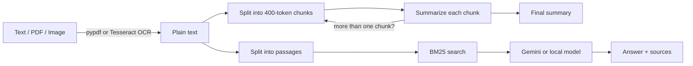

# 📄 Text Summarization using LLM

Summarize long documents and ask questions about your PDFs, using a language model that runs on
your own machine.

[](https://github.com/bhargavmanchala/Text-Summarization-using-LLM/actions/workflows/ci.yml)


## Contents

- [Overview](#overview)
- [Features](#features)
- [How it works](#how-it-works)
- [Quick start](#quick-start)
- [Usage](#usage)
- [Configuration](#configuration)
- [Project structure](#project-structure)
- [Tech stack](#tech-stack)
- [Development](#development)
- [Troubleshooting](#troubleshooting)
- [Limitations and roadmap](#limitations-and-roadmap)
- [License](#license)

## Overview

Reading a 40-page report to find the three points that matter is slow. This app condenses text,
PDFs and even photos of documents into a short summary, and answers questions about a PDF with the
supporting passages shown next to each answer.

It began as a college mini-project and now combines four earlier repositories into one tested
codebase with a clean separation between the UI (`app.py`) and the logic (`textsum/`).

## Features

| | |
|---|---|
| **Summarize anything** | Paste text, upload one or more PDFs, or upload an image (OCR). |
| **Any length** | Long documents are summarized chunk by chunk, then merged, so nothing is cut off. |
| **Length control** | Short, medium or long summaries from a sidebar slider. |
| **Ask your PDF** | Ask a question and get an answer plus the source passages it came from. |
| **Private by default** | Summarization and Q&A run locally. Gemini is used only if you opt in with a key. |
| **Export** | Download the summary as a `.txt` file. |

## How it works



- **Summarization** uses [LaMini-Flan-T5-248M](https://huggingface.co/MBZUAI/LaMini-Flan-T5-248M)
  with beam search. If the document needs more than one chunk, the chunk summaries are summarized
  again (up to three rounds).
- **Question answering** retrieves the most relevant passages with BM25 keyword ranking and asks
  Gemini (if `GOOGLE_API_KEY` is set) or the local model to answer using only those passages.

More detail in [docs/ARCHITECTURE.md](docs/ARCHITECTURE.md).

## Quick start

Requires Python 3.10 or newer and about 2 GB of free disk space for the model and PyTorch.

```bash
git clone https://github.com/bhargavmanchala/Text-Summarization-using-LLM.git
cd Text-Summarization-using-LLM
python -m venv .venv
```

Activate the environment (`.venv\Scripts\activate` on Windows, `source .venv/bin/activate` on
macOS/Linux), then:

```bash
pip install -r requirements.txt
streamlit run app.py
```

Open the URL Streamlit prints (usually http://localhost:8501). The first summary downloads the
model (about 1 GB) and caches it for later runs. It uses a GPU automatically if PyTorch detects one.

## Usage

**Summarize**
1. Open the **Summarize** tab and choose an input: *Paste text*, *PDF* or *Image (OCR)*.
2. Pick a length in the sidebar.
3. Click **Summarize**, then optionally **Download summary**.

**Ask your PDF**
1. Open the **Ask your PDF** tab and upload one or more PDFs.
2. Type a question using words likely to appear in the document.
3. Read the answer and expand **Source passages** to check where it came from.

## Configuration

All settings are optional environment variables (see [`.env.example`](.env.example)).

| Variable | Default | Purpose |
|---|---|---|
| `SUMMARIZER_MODEL` | `MBZUAI/LaMini-Flan-T5-248M` | Hugging Face model id or local folder (any seq2seq model). |
| `GOOGLE_API_KEY` | unset | Enables Gemini for PDF Q&A. Never commit it. |
| `GEMINI_MODEL` | `gemini-1.5-flash` | Gemini model used when a key is set. |
| `TESSERACT_CMD` | unset | Path to the Tesseract executable if it is not on `PATH`. |

PowerShell example:

```powershell
$env:GOOGLE_API_KEY = "your-key"
streamlit run app.py
```

Image OCR needs [Tesseract](https://github.com/tesseract-ocr/tesseract) installed separately.

## Project structure

```
app.py                  Streamlit user interface
textsum/                Core library (no UI code)
  summarizer.py         Chunked map-reduce summarization
  qa.py                 Question answering over retrieved passages
  retrieval.py          BM25 passage search
  pdf_io.py             PDF text extraction
  ocr.py                Image text extraction (Tesseract)
  models.py             Local Hugging Face model wrapper
  config.py             Settings from environment variables
  chunking.py           Text and token chunking helpers
tests/                  Unit tests (fake models, no downloads)
docs/ARCHITECTURE.md    Design notes
.github/workflows/      CI: lint and tests
```

## Tech stack

Python · Streamlit · PyTorch · Hugging Face Transformers · pypdf · Tesseract OCR · Google Gemini
(optional) · pytest · Ruff · GitHub Actions

## Development

```bash
pip install -r requirements-dev.txt
ruff check .
pytest
```

Tests use small fake models, so they run in under a second with no network. Please read
[CONTRIBUTING.md](CONTRIBUTING.md) first; release notes are in [CHANGELOG.md](CHANGELOG.md).

## Troubleshooting

| Problem | Fix |
|---|---|
| First summary is very slow | The model is downloading (about 1 GB). Later runs reuse the cache. |
| `Tesseract is not installed` | Install Tesseract, then add it to `PATH` or set `TESSERACT_CMD`. |
| "No selectable text found" for a PDF | The PDF is scanned. Export its pages as images and use *Image (OCR)*. |
| "I could not find that in the document" | Rephrase using words that appear in the PDF; search is keyword-based. |
| Out-of-memory errors | Close other apps, or set `SUMMARIZER_MODEL` to a smaller model. |
| Gemini errors | Check the key and your network; unset `GOOGLE_API_KEY` to use the local model. |

## Limitations and roadmap

- A 248M-parameter model gives readable but basic summaries. Use a larger model via
  `SUMMARIZER_MODEL` for higher quality.
- Question answering is keyword-based (BM25), not semantic.
- Planned: semantic retrieval with embeddings, Docker image, support for DOCX and web pages.

## License

[MIT](LICENSE) for the code. The default model is licensed **CC BY-NC 4.0 (non-commercial)**; see
[NOTICE.md](NOTICE.md) for third-party licenses.
